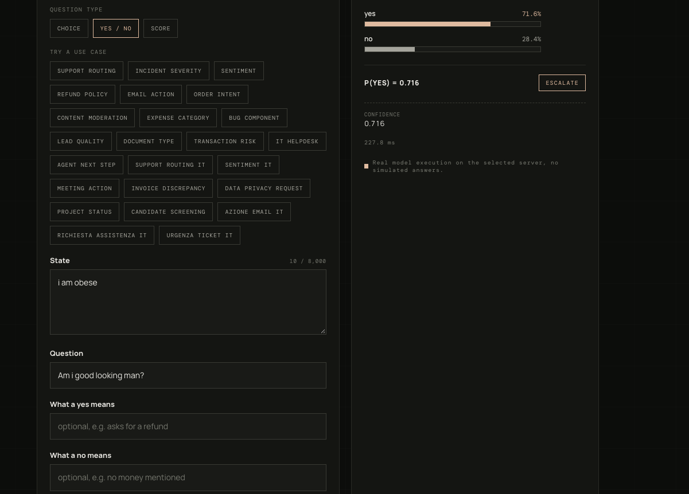

# Playground

[](https://www.python.org/)
[](https://fastapi.tiangolo.com/)
[](https://react.dev/)
[](https://vite.dev/)

The runnable web interface for [ANT-4B](https://github.com/semantique-team/ant-4b).
This repository contains two independent processes:

- `serve/` exposes one or more ANT checkpoints through a FastAPI API.
- the repository root is the Vite + React interface, which connects to that API.

The model package and its checkpoint directories stay in the sibling `ant-4b`
repository. This keeps the interface deployable without copying model weights.



## Prerequisites

- Python 3.10 or later
- Node.js and npm
- a local Qwen backbone directory, or network access to the backbone named in a
  checkpoint's `config.json`
- a checkout layout like:

  ```text
  Projects/
  ├── ant-4b/
  │   └── runs/ant-4b-2026-10-17/
  └── playground/
  ```

## Install

From this repository, install the server and its dependencies. The first command
also obtains the published `ant-4b` package; the second makes the adjacent local
checkout take precedence while developing both repositories.

```bash
cd /path/to/Projects/playground
python -m pip install -e .
python -m pip install -e ../ant-4b

npm install
```

## Serve one model

Start the API in one terminal. `--backbone` is useful when the local Qwen model
is not at the path stored in the checkpoint configuration.

```bash
cd /path/to/Projects/playground
python -m serve \
  --runs ../ant-4b/runs/ant-4b-2026-10-17 \
  --backbone /path/to/Qwen3.5-4B
```

The API listens at `http://127.0.0.1:8000`; its model catalogue is available at
`http://127.0.0.1:8000/api/models`.

In a second terminal, start the web app:

```bash
cd /path/to/Projects/playground
npm run dev
```

Open the Vite URL printed in the terminal, add `http://127.0.0.1:8000` in the
server panel, then select the model and submit a decision.

## Serve multiple models

Pass every checkpoint directory after `--runs`. Each directory must contain an
`ant_head.pt` and `config.json`, and their final directory names must be unique:

```bash
python -m serve \
  --runs \
    ../ant-4b/runs/ant-4b-2026-10-17 \
    /path/to/another-ant-checkpoint \
  --backbone /path/to/Qwen3.5-4B
```

The first run is selected by default. The server returns all runs from
`GET /api/models`; the playground automatically displays them in its model
selector, grouped by server. Selecting a model sends that model name in the
decision request. The server loads models lazily and keeps only one predictor in
memory at a time, so adding a model does not load every backbone immediately.

You may also add several API URLs in the interface. Their models appear as
separate groups in the same selector.

## Notes

- Checkpoints using the `mock` backbone are rejected by default because their
  predictions are not meaningful. Use `--allow-mock` only for tests or UI demos.
- The server accepts a checkpoint's configured Hugging Face backbone when it is
  available locally or can be downloaded. `--backbone` overrides that location
  for every real-backbone checkpoint served by that process.
- Checkpoint metadata such as `card.json`, `examples.json`, calibration, and
  escalation policy remain alongside each checkpoint and are exposed to the UI.
